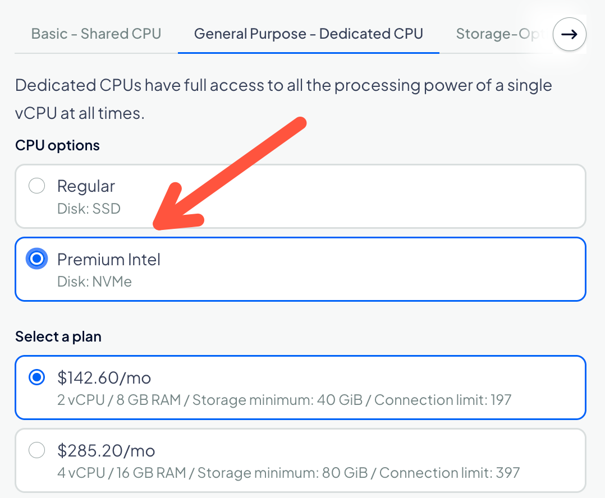
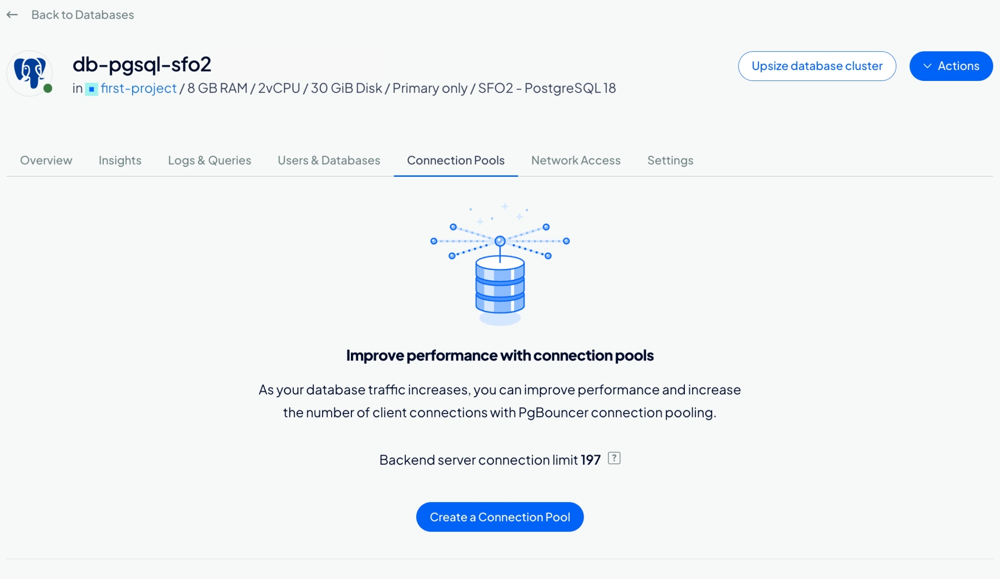
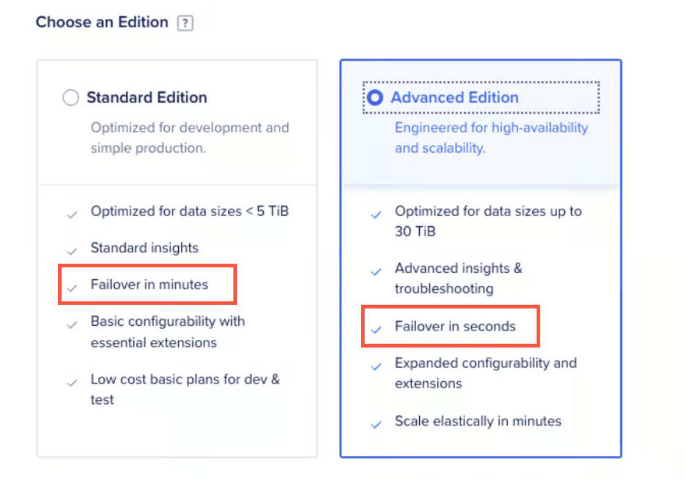

# Intro

Don’t you hate it when things get worse?

Degrading quality appears to be a common theme in our modern life. Less so in the tech world, but we have generally become accustomed to seeing the price of things rise while the quality remains the same, or the quality go down while the price remains the same.

It's rare, and disappointing, to see both things happen at once.  
It's extremely annoying to see them both happen _in tech_.

---
  

  
TL;DR (click to expand)

DigitalOcean's new "Advanced" database is basically shrinkflation and inflation packaged in a SaaS product.

Over two weeks, I created <u>100+ databases and ran 59 hours of benchmarks</u> to show that the new Advanced tier is a significant performance regression over the old Standard tier it replaces:

- up to 436% higher p99 write latency (6.7 ms -> 35.9 ms at 32 vCPU)
- ~70% fewer writes/s and ~61% fewer reads/s on average. Even at 32 vCPU, it tops out to:
  - 54k reads/s, about a quarter of Standard's 204k/s reads
  - 6.9k writes/s (vs 26.5k/s on Standard)
- ~5x slower startup times (3m 19s -> 16m 06s, averaged across 15 regions)

Of course, the marketing launch blog post claimed the opposite - 50% lower p99 latency and 38% higher throughput.

To top it off, it can cost ~10% more for the same CPU, RAM and disk at certain average db sizes. But if you actually account for the read/write capability lost - it works out to 3.2x-3.8x more for the same TPS number.

  

 
 -------

DigitalOcean recently began sunsetting their Standard PostgreSQL database SaaS offering in favor of a new, "Advanced" version.
The new offering is more expensive at certain small/average sizes and it is going to be the only option going forward for sizes >2 vCPU.

But, one may say, [it promises a lot more](https://www.digitalocean.com/blog/introducing-mysql-postgresql-advanced), including:

- being "Engineered for **scalability**."
- rapid failover which avoids application reconnects (through a connection pooler proxy), in under 3 seconds on average.
- having up to 38% higher throughput ALONGSIDE a 50% reduction in p99 latency.
- They also have some misleading wording in the announcement blog post suggesting a 46% price reduction, but that's just from the past Advanced price to the present Advanced price. It isn't significantly cheaper than Standard, and in some cases it's more expensive.

In other words, [they're claiming the new Postgres](https://www.digitalocean.com/blog/introducing-mysql-postgresql-advanced) is both much faster and much higher throughput, at the same time.

So I put it to the test: I ended up running 59 hours' worth of benchmarking over two weeks[^test-detail]. And found no claim to be true.

# What I tested

1. Max Write TPS per tier (& p95, p99 latency)
2. Max Read TPS per tier (& p95, p99 latency)
3. Cold Startup Times per tier

All the tests were ran on the General Purpose tier, with dedicated "Premium Intel" vCPUs and NVMe disks ([some info on these](https://docs.digitalocean.com/products/droplets/concepts/choosing-a-plan/#plans-general-purpose))

{: width="350"}

---

# Results

# Throughput per Tier

I spun up two parallel Standard and Advanced databases on every tier from 2 vCPU to 32 vCPU. I had to rush through the tests, because [on November 30 the Standard equivalent of 4-32 vCPU will no longer be deployable](https://privatedevops.com/news/digitalocean-database-plan-changes-october-15) - the only option will be the more-expensive Advanced.

The tests run PG 18, spin up one DB node and one or more Droplets in the same region (SFO2). The droplets use the standard [pgbench](https://www.postgresql.org/docs/current/pgbench.html) testing tool, which is configured to warm up for 1 minute then time the results for 5 minutes. Before each run, I recreated the data[^data-scale]. Each run used a different amount of persistent connections[^persistent-connections]. All settings were left at their defaults. Each tier test got run 3 times and the results you'll see are the average out of all the runs. Standard stuff.

Remember, for throughput they claim[^perf-claim-explanation]:

> "Performance Gains at Scale: ... delivering up to **38% higher throughput** alongside a 50% reduction in p99 latency."

## Test 1 — Write TPS

These tests use pgbench’s [built-in TPC-B-like workload](https://github.com/postgres/postgres/blob/8a8ee213df27c3de62df889e3e7002735c47110a/src/bin/pgbench/pgbench.c#L792-L806). Each transaction in the TPS here consists of three UPDATEs, one SELECT and one INSERT.

~~~sql
BEGIN
  UPDATE pgbench_accounts SET abalance = abalance + :delta WHERE aid = :aid;
  SELECT abalance FROM pgbench_accounts WHERE aid = :aid;
  UPDATE pgbench_tellers SET tbalance = tbalance + :delta WHERE tid = :tid;
  UPDATE pgbench_branches SET bbalance = bbalance + :delta WHERE bid = :bid;
  INSERT INTO pgbench_history (tid, bid, aid, delta, mtime)
    VALUES (:tid, :bid, :aid, :delta, CURRENT_TIMESTAMP);
END;
~~~

The averaged-out results:

| Size | Standard Write TPS | Advanced Write TPS | Difference |
|---|---:|---:|---|
| 2 vCPU / 8 GiB | 2,074 | 639 | 69.2% lower |
| 4 vCPU / 16 GiB | 3,983 | 1,641 | 58.8% lower |
| 8 vCPU / 32 GiB | 13,227 | 3,768 | 71.5% lower |
| 16 vCPU / 64 GiB | 22,740 | 6,048 | 73.4% lower |
| 32 vCPU / 128 GiB | 26,489 | 6,891 | 74.0% lower |

"Advanced" supports **~70% fewer write transactions per second** than Standard **out of the box**. That is a ridiculous downgrade.

Digging further, I saw that Advanced had enabled [synchronous_commit](https://postgresqlco.nf/doc/en/param/synchronous_commit/) by default while Standard hadn't. I set both to `on` and tested again:

| Size | Standard | Advanced | Difference |
|---|---:|---:|---:|
| 2 vCPU / 8 GiB | 1,603 | 776 | 51.6% lower |
| 4 vCPU / 16 GiB | 3,417 | 1,368 | 60.0% lower |
| 8 vCPU / 32 GiB | 9,044 | 3,859 | 57.3% lower |
| 16 vCPU / 64 GiB | 13,723 | 6,571 | 52.1% lower |
| 32 vCPU / 128 GiB | 22,122 | 6,718 | 69.6% lower |

With both set to `on`, Standard's TPS expectedly dropped at every size, yet Advanced still had **50-70% less throughput**. 🤯

## Test 2 — Read TPS

The read test uses pgbench’s [select-only workload](https://github.com/postgres/postgres/blob/8a8ee213df27c3de62df889e3e7002735c47110a/src/bin/pgbench/pgbench.c#L821-L824). Each transaction fetches one account balance using a randomly chosen account ID. 

~~~sql
SELECT abalance FROM pgbench_accounts WHERE aid = :aid;
~~~

| Size | Standard Read TPS | Advanced Read TPS | Difference |
|---|---:|---:|---|
| 2 vCPU / 8 GiB | 13,858 | 6,617 | 52.3% lower |
| 4 vCPU / 16 GiB | 26,582 | 15,168 | 42.9% lower |
| 8 vCPU / 32 GiB | 94,785 | 34,038 | 64.1% lower |
| 16 vCPU / 64 GiB | 166,617 | 45,797 | 72.5% lower |
| 32 vCPU / 128 GiB | 203,544 | 54,040 | 73.4% lower |

"Advanced" supports ~61.0% fewer reads per second than Standard. Brutal.

A customer would be furious if his standard database degraded like this overnight. And DigitalOcean is selling this as an Advanced option.

Advanced seems to peak out at around 40-60k Read TPS. I dove further into why this could be and I believe the bottleneck is **the connection pooler** (PgBouncer). More on this in the last paragraph.

## Latency per Tier

Remember, for latency DigitalOcean claim:

> "Performance Gains at Scale: ... delivering up to 38% higher throughput alongside **a 50% reduction in p99 latency**."

Every write and read transaction from the TPS tests logged a random 1% of all the transactions. Lets see how Advanced did on latency.

## Test 3 - Write Latency

Here are the latencies for the write transactions. Each one runs the 5 data statements I showed earlier, so the numbers are for the whole transaction:

| Size | Standard p99 | Advanced p99 | p99 diff | Standard p95 | Advanced p95 | p95 diff |
|---|---:|---:|---:|---:|---:|---:|
| 2 vCPU / 8 GiB | 9.8 ms | 41.6 ms | **4.2×** | 6.9 ms | 23.3 ms | **3.4×** |
| 4 vCPU / 16 GiB | 8.7 ms | 25.2 ms | **2.9×** | 5.8 ms | 17.3 ms | **3.0×** |
| 8 vCPU / 32 GiB | 4.8 ms | 18.7 ms | **3.9×** | 3.6 ms | 12.6 ms | **3.5×** |
| 16 vCPU / 64 GiB | 4.9 ms | 22.4 ms | **4.6×** | 3.6 ms | 16.0 ms | **4.4×** |
| 32 vCPU / 128 GiB | 6.7 ms | 35.9 ms | **5.4×** | 5.2 ms | 23.7 ms | **4.6×** |

Advanced was a lot slower at every tier. The write latency was **200-440% higher**.

The median latency (p50) also went up from 1.9ms to 5.5ms.

## Test 4 - Read Latency

| Size | Standard p99 | Advanced p99 | p99 diff | Standard p95 | Advanced p95 | p95 diff |
|---|---:|---:|---:|---:|---:|---:|
| 2 vCPU / 8 GiB | 2.00 ms | 3.91 ms | **2.0×** | 1.11 ms | 2.16 ms | **1.9×** |
| 4 vCPU / 16 GiB | 1.63 ms | 2.83 ms | **1.7×** | 0.95 ms | 1.73 ms | **1.8×** |
| 8 vCPU / 32 GiB | 0.71 ms | 2.24 ms | **3.2×** | 0.52 ms | 1.45 ms | **2.8×** |
| 16 vCPU / 64 GiB | 0.54 ms | 2.98 ms | **5.5×** | 0.46 ms | 2.03 ms | **4.4×** |
| 32 vCPU / 128 GiB | 0.74 ms | 4.17 ms | **5.6×** | 0.64 ms | 3.04 ms | **4.8×** |

Advanced was again slower at every instance size, and by a lot: **70–460% higher latency**. Albeit this is at a lower base and most would argue the difference between 2ms->4ms is not important.

## Startup Time

One thing that became immediately apparent to me while testing was the time it took to spin up the database. As I was first playing around with the UI, I noticed I had a lot of time to alt+tab until the infra I wanted got provisioned. So I tested this too.

## Test 5 - Startup Time

Here I basically created one new 2vCPU database, in each region, sequentially, and timed how long it took for it to be ready. The timer starts from the moment the create request goes out and stops at the moment the database answers its first query.

| Region | Standard | Advanced | Diff |
|---|---:|---:|---:|
| San Francisco (SFO2) | 3m 38s | 13m 46s | 3.8× |
| San Francisco (SFO3) | 3m 29s | 14m 55s | 4.3× |
| Toronto (TOR1) | 3m 13s | 12m 10s | 3.8× |
| New York (NYC1) | 3m 22s | 12m 39s | 3.7× |
| New York (NYC2) | 2m 36s | 12m 35s | 4.8× |
| New York (NYC3) | 2m 48s | 13m 00s | 4.6× |
| Atlanta (ATL1) | 2m 53s | 12m 10s | 4.2× |
| Richmond (RIC1) | 2m 57s | 12m 26s | 4.2× |
| Kansas City (MKC1) | 3m 03s | 13m 25s | 4.4× |
| London (LON1) | 2m 32s | 14m 50s | 5.9× |
| Amsterdam (AMS3) | 2m 41s | 16m 00s | 6.0× |
| Frankfurt (FRA1) | 3m 31s | 16m 30s | 4.7× |
| Bangalore (BLR1) | 3m 18s | 24m 51s | 7.5× |
| Singapore (SGP1) | 4m 13s | 30m 01s | 7.1× |
| Sydney (SYD1) | 5m 35s | 22m 12s | 4.0× |
| **Average, 15 regions** | **3m 19s** | **16m 06s** | **4.8×** |

On average, Advanced took **about five times as long** to start as Standard. And that's on the smallest 2vCPU tier, the one that should be the easiest to provision.

Again, why could this regression be? DigitalOcean, you had it working fast before...

# Price

Onto the cost of this "upgrade". It's somewhat of a fair trade:

- Advanced costs **19.4%-26.5% more** per vCPU.[^compute-prices]
- Advanced's storage costs **46.5% less** per GiB (\$0.215/GiB -> \$0.115/GiB)

There are a lot of possible permutations to test here, namely because of having different CPU tiers (Regular, Premium Intel), different database tiers (General-Purpose, Storage-Optimized) and the fact that Advanced upped the minimum amount of disk you have to deploy with.[^limit]

The price comparison ends up depending heavily on how much disk you buy.[^disk-price-mention] I won't bore you to death with all the details here, here's a summary:

| Disk scenario[^average-cell-callout] | Premium Intel (NVMe) | Regular (SSD) |
|---|---:|---:|
| General Purpose: each edition’s own minimum | +17.0% more expensive | +20.1% more expensive |
| General Purpose: both at ~50% of each matching Standard plan’s old maximum | +10.2% | +12.3% |
| General Purpose: both at Standard’s old maximum | +3.4% at 5,000 GiB | −2.2% at 4,800 GiB |
| Storage Optimized: both at 50% of each matching Standard plan’s old maximum | −8.5% | −13.5% |
| Storage Optimized: both at Standard’s old maximum | −22.5% at 30 TiB | −14.5% at 15 TiB |

1. At the minimum disk size it's **17%-20% more expensive**.
2. Max out the disk to the old limits (up to what Standard allowed) and they're roughly equal (-2.2% to +3.4%)
3. Max out the disk in the Storage-Optimized type and Advanced becomes cheaper (by **~17%**)

Essentially, we see that the minimum database cost has gone up by ~20%, the very maximum disk size deployments have gone down by ~20% and the median[^median-assumption] has become ~10% more expensive, mainly due to the CPU pricing.

And so nobody says that Advanced costs more per vCPU because of the new connection pooler that's included -- Standard had a free connection pooler addon you could opt in to.

As we will now see, this pooler can be a footgun.

# the PgBouncer bottleneck

If you notice the test results, Advanced didn't do much more TPS after upgrading from 16 vCPU to 32 vCPU - writes only went from 6048 to 6891 and reads 45797 -\> 54040. This low ceiling perplexed me, so I dug into it further.

I quickly found something peculiar: the type of query made practically no difference.

Even a trivial `SELECT 1` still hit the same statement per second ceiling. But when I batched 10 reads per transaction, Advanced managed to execute 221k statements/s instead of 47k/s. [^batching-explanation]

So the database could clearly handle far more queries. Something in front of it wasn't sending them fast enough. My suspicion fell on the connection pooler.

## Connection Pooler

Postgres is poor at handling many connections (each connection is a new OS process). It's considered good practice to deploy a connection pooler alongside it.

> 📖 **Connection Pooler**: software that groups multiple client connections together and exposes the underlying database to less connections. It also does the heavy work of handling TLS handshakes. 

DigitalOcean uses [pgBouncer](https://www.pgbouncer.org/) as its built-in pooler.[^figured-pgbouncer-out] 

The Advanced databases have PgBouncer put in front of them by default, with no way to opt out. With Standard, an ops team would usually deploy it themselves (via Droplets), or use the built-in free one by clicking the "create a connection pooler" button: {: width="900"}

The problem comes with this built-in Advanced pooler. PgBouncer is single-threaded per process, and we can't see *nor control* how many processes DigitalOcean runs behind the scenes.

It looks like they're running a small, fixed pooler setup whatever plan size you buy. That's why Advanced doesn't scale much with some plans: at some size threshold (~16vCPU?), the pooler processes become the bottleneck. A bigger database doesn't make the pooler faster.

I tested this theory out and the numbers matched. I spun up a Standard 32 vCPU database and ran a few connection pooler setups with it - the default built-in one, no pooler, and a few poolers I managed myself inside Droplets.

| Setup | Reads/s | Write TPS | vs direct |
|---|---:|---:|---:|
| **Direct (no pool)** | **204,929** | **28,145** | **<u>100%</u>** |
| DigitalOcean's built-in pool | 33,113 | 4,935 | 16–18% |
| 1 PgBouncer Droplet[^pgbouncer-droplet-explanation], 1 process | 30,003 | 4,373[^statement-top-out] | 15–16% |
| 1 droplet, 2 processes | 63,309 | 8,373 | 30–31% |
| 1 droplet, 8 processes | 82,583 | 11,803 | 40–42% |
| 2 droplets, 8 processes each | 165,059 | 22,851 | 81% |
| 3 droplets, 8 processes each | 197,222 | 24,930 | 89–96% |
| 4 droplets, 8 processes each | 196,313 | 24,944 | 89–96% |

- Pools definitely kill throughput - direct connections on a 32 vCPU DB did 205k reads/s and the built-in pool got it down to 1/6th at 33k/s (rows 1 & 2)
- As you can see, the built-in pool on a Standard database matches a 1-process setup. (rows 2 & 3)
- The built-in pool on an Advanced database seems to match a 2-process setup.[^statement-breakdown]

**It seems like like Advanced cannot scale beyond this.** Adding a bigger DB didn't work. Increasing connections only made it worse[^connection-mention]. We aren't allowed to configure the pooler. There's no supported way to connect around the pooler...[^pooler-conn-support]

What would work is asking application developers to rewrite all their code in order to batch more statements per round trip. That's obviously not a realistic ask, especially not when all you want is a simple experience.

We can't know for certain where the problem with this new "Advanced" database is. Like any SaaS, this crucial infrastructure data is hidden away from you. So we can just guess.

My guess is that DigitalOcean is running two pooler instances with one process each. The numbers match two processes[^statement-breakdown], during one 16 vCPU test I saw two explicit pooler addresses and it makes some sense to run two instances[^multi-pooler-reason].

So my conclusion is that DigitalOcean doesn't give PgBouncer enough capacity. I'm paying for a 32 vCPU database, but the pooler in front is preventing me from making full use of those cores.

# Failover

Last-but-not-least, DigitalOcean [claims](https://www.digitalocean.com/api/static-content/v1/images?src=https%3A%2F%2Fdoimages.nyc3.cdn.digitaloceanspaces.com%2F002Blog%2FD%2520%26%2520L%2520-%2520Blog%2520Image.png&token=ace8ce6b7c993c0567da66e9b75d4c69c4dfea7329c7d0f5cbf837c9d00ef827) that Advanced fails over in seconds while Standard fails over in minutes.

 {: width="650"}

I couldn't make the DB die to test an actual failover, so I did the closest next thing: an instance resize. This also tests some of the reconnection claims they made:

> Advanced was built to remove the impact of database node rotations **both for planned events like a maintenance installation** or an unplanned failover. With a built in proxy, your application **generally does not need to reconnect** if the primary changes.

On a cluster with a standby, every CPU/RAM resize moves the primary to a new machine. So I created a 2 vCPU Standard and Advanced cluster, each with one standby, and resized each one up and down twice: 4 resizes per database. I tested Standard directly, Standard through DO's pool, and Advanced. Each setup kept eight persistent test connections open, without immediately reconnecting after errors. A separate workload kept sending queries and reconnected after errors.

| Result | Standard | Standard + DO's pool | Advanced |
|---|---|---|---|
| Application reconnects required | Yes | Yes | Yes |
| Acknowledged writes lost | 0 | 0 | 0 |

Advanced's proxy did not remove the need for application reconnects during these planned resizes. Each of the three setups lost all eight persistent test connections during every resize, so applications still had to reconnect.

This may be expected if you read the fine print. Yet another marketing crime DigitalOcean committed was that the second-level node replacement was only tested on MySQL Advanced:

> Rapid Failover Capabilities: Integrated proxy architecture is designed to avoid application reconnects in most failover events. Across twenty primary-loss simulations in internal benchmarking, **MySQL Advanced Edition clusters** promoted a replacement primary in under 3 seconds on average, remaining well within standard client connection retry thresholds.

Postgres Advanced couldn't avoid reconnects during a planned resize. Forgive me if I'm a little skeptical in believing that it can avoid reconnections during an abrupt, unexpected failover.

# Verdict

DigitalOcean is outright downgrading its Standard database offering with its new "Advanced" option across all tiers.

The new option is up to 436% slower for writes (despite claiming[^latency-claim] to be 50% faster) and has up to 73% less throughput (despite claiming up to 38% more throughput).

The new tier is marketed for enterprise scale, yet even at 32 vCPU, it struggles to push beyond 54k reads and 7k writes per second. (4x less than standard)

The biggest Advanced plan, 32 vCPU at $2,670/mo, did about half the work of an 8 vCPU Standard at $588/mo. For the same amount of work (priced solely in transaction-per-second capability), Advanced costs 3.8x as much for writes and 3.2x as much for reads (averaged over the five sizes). 

To top it off, it takes ~5x longer to start up.

---

# PS: Got Quality Control?

What I find most baffling is how this ever passed DigitalOcean's internal testing.

Advanced DB have been live (in Public Preview) since April 2026. It went GA in September. And in two weeks weeks, we're losing Standard for anything above 4 GiB of RAM.

Did nobody run a simple basic latency & throughput benchmark comparing Standard against Advanced? 

I literally just turned on two default databases, tested and immediately found red flags...

After this whole Advanced launch fiasco, I have considerably less confidence in DigitalOcean's ability to deliver a proper database SQL service.

Was it entirely vibe-coded? I can't explain the seemingly sudden drop in quality. The whole thing makes no sense to me.

What on earth happened here?

---

[^limit]: Further limiting your ability to deploy small databases... which I'm not a fan of

[^disk-price-mention]: Since the per GiB price is lower on Advanced, the more disk you buy the closer the comparative price between both tiers (Standard & Advanced) becomes.

[^min-disk-size]: Standard Regular SSD is 30 GiB, Advanced Regular SSD is 50 GiB; Standard Premium Intel is 80 GiB, Advanced Premium Intel is 120 GiB. We aren't comparing apples to apples here because Advanced won't let you go as low as Standard does. But it's important to say that this means you can no longer deploy small databases with 30 GiB of space - you're forced to pay more for what you don't need. This price spike triples when you deploy 3x for HA.

[^figured-pgbouncer-out]: I figured this out by seeing PgBouncer specific error messages during some of the resize tests, like ["server conn crashed?"](https://github.com/pgbouncer/pgbouncer/blob/pgbouncer_1_26_1/src/server.c#L812).

[^sync-commit-wording]: Truth be told, testing it on or off did not materially change the results at all. The important thing was for them to be equal.

[^pgbouncer-droplet-explanation]: My PgBouncer ran on 16 vCPU Droplets, but a single process can only use one vCPU. It sat at 100% of that one core while the other 15 did nothing.

[^statement-top-out]: My 1-process PgBouncer used 100% of a single core and topped out at about 30,000 statements per second. 30k single `SELECT` statements, or 30.6k write statements. (The 4,373 write transactions consist of 7 statements each - `BEGIN`, `UPDATE`, `SELECT`, `UPDATE`, `UPDATE`, `INSERT`, `END`).

[^connection-mention]: It got slower the more connections I added - e.g 18.6k statements per second at 512 connections (down from 30k/s). Which makes sense, as the CPU core is pinned at 100% already.

[^average-cell-callout]: Each cell is the average of the five (2 vCPU to 32 vCPU) tiers with the same amount of disk.

[^statement-breakdown]: The 2-process PgBouncer (row 4) on my Standard database test topped out at 63k reads and 8.3k writes. The earlier 32 vCPU Advanced tests topped out at 54k reads and 6.9k writes - it's the closest I could get.

[^pooler-architecture]: I figured this out in two ways - 1) the pool's hostname was the same as the database's, and 2) Postgres saw every pool connection arrive from 127.0.0.1 (localhost).

[^perf-claim-explanation]: The blog post is written very sloppily. First, they credit the perf gains to both engines: "As database activity accelerates, both engines demonstrate marked efficiency improvements, with Managed PostgreSQL internal benchmarks delivering up to 38% higher throughput alongside a 50% reduction in p99 latency." But [the fine print in the benchmarks](https://www.digitalocean.com/api/static-content/v1/images?src=https%3A%2F%2Fdoimages.nyc3.cdn.digitaloceanspaces.com%2F002Blog%2FVisual%25205%2520-%2520Advanced%2520Edition%2520Footnoe.png&token=a05f4ee102261fcbc592245020fd1cd756c8b40b396dd1010a627e58f308e60f) show it's the Advanced database that shows this. This is also shown in their [Advanced vs Standard comparison table](https://www.digitalocean.com/api/static-content/v1/images?src=https%3A%2F%2Fdoimages.nyc3.cdn.digitaloceanspaces.com%2F002Blog%2FVisual%25201%2520-%2520Advanced%2520Edition%2520GA%2520Blog.png&token=533f2dda556fe59c02fdf1d1c36b7f346dd255e0ed61a0f97eabda3e7d9fdb3e)

[^batching-explanation]: With batching, each `pgbench` transaction sent 10 read queries at a time instead of one. That helped Advanced get 4.7x more statements/s (47k/s /w no batches vs 221k/s at 22k batches/s) through the pooler. The DB still executed each query separately - there wasn't query grouping. This batching further proved that the bottleneck was the pool, as I could now sample 11+ queries in flight (through `pg_stat_activity`). Before I could only sample ~2.

[^latency-claim]: Fun note - if you read in the fine print of their latency claim, you'll see that [their benchmark says](https://web.archive.org/web/20260923173330/https://www.digitalocean.com/cdn-cgi/image/quality=75/https://www.digitalocean.com/api/static-content/v1/images?raw=1&src=https%3A%2F%2Fdoimages.nyc3.cdn.digitaloceanspaces.com%2F002Blog%2FVisual%25205%2520-%2520Advanced%2520Edition%2520Footnoe.png) that it only applies **during a failover**. Yet, they're happy to quite literally say ["delivering up to 38% higher throughput* alongside a 50% reduction in p99 latency."](https://www.digitalocean.com/blog/introducing-mysql-postgresql-advanced#:~:text=to%2038%25%20higher%20throughput*%20alongside%20a%2050%25%20reduction%20in%20p99%20latency.**). Very sleazy marketing.

[^pooler-conn-support]: Which, btw, is another thing DigitalOcean Advanced falls short of. Postgres providers like Supabase and Neon intentionally give you both hostnames (`db.neon.tech` vs `db-pooler.neon.tech`). The reason is that migrations, `pg_dump`, long analytics queries, replication and other work that requires session features needs a direct connection to work reliably. Even [DigitalOcean docs recommend](https://docs.digitalocean.com/products/databases/postgresql/how-to/manage-connection-pools/#:~:text=We%20recommend%20you%20use%20pg_dump%20directly%20against%20your%20database%20cluster%2C%20bypassing%20its%20connection%20pool(s)) you run `pg_dump` directly against the database. Advanced doesn't allow you to do this...

[^compute-prices]: Premium Intel CPUs cost 19.4% more (\$67/m -> \$90/m) and Regular CPUs cost 21.5–26.5% more (\$51-54/m -> \$65/m).

[^multi-pooler-reason]: In order to avoid a SPoF in the pooler path, it's a good idea to run two instances. If one fails, clients can connect to the other. This also helps with upgrading/restarting the pooler.

[^test-detail]: The tests ran Oct 30 - Nov 14, 2026. I went through ~100+ database creations and paid a few hundred dollars for this data.

[^data-scale]: I used [pgbench scale 100](https://www.postgresql.org/docs/current/pgbench.html#PGBENCH-OPTION-SCALE-INIT), which creates 10 million rows in `pgbench_accounts`.

[^persistent-connections]: I used 8, 16, 32, 64 and 100 persistent connections for the 2, 4, 8, 16 and 32 vCPU plans, respectively.

[^median-assumption]: I don't know for a fact what the median database deployment at DigitalOcean is. But I believe it's a fair assumption to think that disk is never close to being maxed out for the majority of users.
